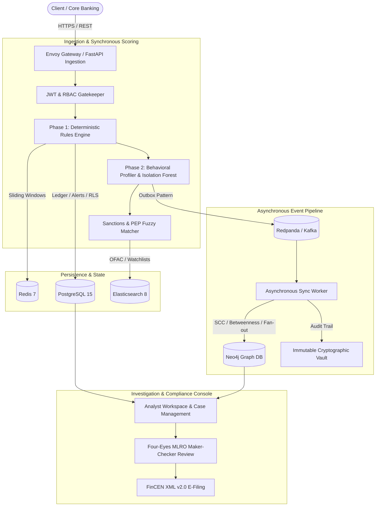

# AML Sentinel — Enterprise Transaction Monitoring & Compliance Platform

[](https://www.python.org/)
[](https://fastapi.tiangolo.com/)
[](https://www.postgresql.org/)
[](https://neo4j.com/)
[](https://redis.io/)
[](https://www.elastic.co/)
[](https://redpanda.com/)
[](https://docs.pytest.org/)

An enterprise-grade, high-performance Anti-Money Laundering (AML) transaction monitoring, investigation, and regulatory compliance platform. Built for financial institutions and fintechs, AML Sentinel combines real-time deterministic rule evaluation, behavioral machine learning anomaly scoring, graph relationship intelligence, and end-to-end case management with automated FinCEN regulatory filing.

---

## Technical Architecture

AML Sentinel follows a hybrid microservice and asynchronous event-driven pipeline designed for low-latency ingestion (<50ms) and high-throughput background analytics.



### Core Tech Stack

| Component | Technology | Role in System |
| :--- | :--- | :--- |
| **API Engine** | FastAPI (Python 3.10+, Pydantic v2) | High-concurrency async REST gateway & ingestion |
| **Relational DB** | PostgreSQL 15+ (Alembic) | Multi-tenant ledger, accounts, alerts, fail-closed RLS |
| **Graph DB** | Neo4j 5.x (Bolt Protocol) | UBO corporate hierarchy, circular loops (SCC), mule fan-in/fan-out |
| **In-Memory Store** | Redis 7.x | 24-hour sliding window structuring, velocity states, distributed locks |
| **Search Engine** | Elasticsearch 8.x | Levenshtein fuzzy matching across OFAC, PEP, and sanctions lists |
| **Message Broker** | Redpanda (Kafka-compatible) | Decoupled event streaming & transactional outbox sync |
| **Observability** | OpenTelemetry & Jaeger | Distributed request tracing, Prometheus metrics, health probes |
| **Security & IAM** | Asymmetric RS256 JWT, Argon2/Bcrypt | Multi-role RBAC, token rotation, TOTP MFA, optional Vault secrets |
| **Frontend UI** | Responsive HTML5 / Tailwind / React / TS | Analyst investigation consoles, SAR editor, 360 dossiers |

---

## Core Detection & Compliance Pipeline

### Phase 1: Real-Time Deterministic Rule Engine
Configured via `rules_config.json` with dynamic live-tuning support:
* **Large Transaction Monitoring**: Detects single transactions exceeding regulatory thresholds.
* **Structuring (Smurfing)**: Detects sliding 24-hour windows where multiple transactions individually under the threshold sum above it.
* **Velocity Anomaly Detection**: Flags count and volume spikes against rolling statistical baselines (Z-score > threshold).
* **Rapid Movement of Funds**: Catches accounts where inbound funds are routed outbound within 10 minutes at a $\ge 90\%$ ratio.
* **Dormant Account Awakening**: Flags dormant accounts suddenly executing high-value movements.
* **Geographic & Sanctions Risk**: Flags high-risk SWIFT BIC codes, jurisdictional embargoes, and high-risk corridors.

### Phase 2: Behavioral Profiling & ML Anomaly Scoring
* **Dynamic Baseline Profiles**: Automatically tracks customer behavior baselines (average/median volumes, top counterparties, channel/device fingerprints).
* **Isolation Forest Structural Scorer**: Unsupervised ML anomaly detection catching multi-dimensional outliers.
* **Dynamic Blended Risk Scorer**: Calculates a normalized threat level combining rule triggers, ML anomaly scores, and entity risk factors.

### Phase 3: Graph Intelligence & Topology Analytics
Synchronized via the background worker into Neo4j:
* **Circular Flow Detection**: Identifies circular fund loops ($\ge 2$ hops) using Tarjan's Strongly Connected Components (SCC).
* **Fan-In / Fan-Out Topologies**: Pinpoints money mule aggregators (many-to-one) and layering distributors (one-to-many).
* **Transit Intermediaries**: Computes Brandes' Betweenness Centrality to isolate critical middleman accounts.
* **Corporate UBO Mapping**: Traces beneficial ownership networks and shell company relationships.

### Phase 4: Case Management & Regulatory Reporting
* **Investigation Workflow FSM**: Enforces strict status transitions (`NEW` $\rightarrow$ `UNDER_INVESTIGATION` $\rightarrow$ `ESCALATED` $\rightarrow$ `DISMISSED` / `SAR_REQUIRED`).
* **Distributed Investigation Locks**: Redis-backed locks prevent concurrent analyst collision on identical alerts.
* **Four-Eyes Maker-Checker Review**: Dispositions require Senior Analyst / MLRO dual-authorization.
* **FinCEN XML v2.0 E-Filing**: Automated generation, schema validation, and batching of Suspicious Activity Reports (SAR) and Currency Transaction Reports (CTR).
* **Customer 360 & EDD**: Risk appetite alignment, automated account freezing/restriction, and Enhanced Due Diligence dossiers.

### Phase 5: Enterprise Governance & Zero-Trust Security
* **Multi-Tenant Row-Level Security**: PostgreSQL fail-closed RLS policies guarantee strict isolation between institution tenants.
* **Cryptographic Tamper-Evident Audit Vault**: Immutable, append-only audit trail with `SHA-256` hash chaining for regulatory audits.
* **Secret Management & Key Rotation**: Asymmetric RSA token rotation with optional HashiCorp Vault backend.

---

## Getting Started

### 1. Prerequisites
* **Docker & Docker Compose** (v2.20+)
* **Python 3.10+** (Python 3.11 recommended)
* **Node.js 18+** *(optional, for frontend typecheck)*

### 2. Clone & Configure Environment
Clone the repository and copy the environment template:
```bash
cp .env.example .env
```

> [!NOTE]
> In local development, PostgreSQL binds to host port `5433` (rather than standard `5432`) to avoid conflicts with existing local databases. Elasticsearch, Neo4j, Redis, and Redpanda bind to loopback addresses.

### 3. Start Infrastructure Services
Boot up PostgreSQL, Neo4j, Redis, Redpanda, Elasticsearch, and Jaeger:
```bash
docker-compose up -d
```

Verify service containers are healthy:
```bash
docker-compose ps
```

### 4. Set Up Python Environment
Create and activate a virtual environment, then install requirements:

**Linux / macOS:**
```bash
python3 -m venv .venv
source .venv/bin/activate
pip install -r requirements.txt
```

**Windows (PowerShell):**
```powershell
python -m venv .venv
.venv\Scripts\Activate.ps1
pip install -r requirements.txt
```

### 5. Run Database Migrations & Initial Seed
Apply all **23 Alembic revisions** to establish tables, fail-closed RLS policies, and indexes, then seed test entities, accounts, and sanctions watchlists:
```bash
# Apply schema migrations
alembic upgrade head

# Seed initial tenants, mock accounts, users, and watchlist indices
python scripts/init_db.py
```

### 6. Start Application & Workers

Launch the FastAPI Ingestion Gateway:
```bash
uvicorn main:app --host 0.0.0.0 --port 8000 --reload
```

In a separate terminal, launch the asynchronous event sync worker (syncs scored transactions to Neo4j and Elasticsearch):
```bash
python scripts/sync_worker.py
```

---

## Web Console & Analyst Interfaces

Once running, access the interactive interfaces in your browser:

| Interface | URL | Description |
| :--- | :--- | :--- |
| **Institutional Portal** | `http://localhost:8000/` or `/landing` | System overview, capabilities, and executive status |
| **Analyst Login** | `http://localhost:8000/login` | Secure session authentication with HttpOnly cookies |
| **Operations Dashboard** | `http://localhost:8000/dashboard` | Real-time transaction volume, threat distribution, and alerts |
| **Alert Triage Inbox** | `http://localhost:8000/alerts/triage` | Analyst inbox with live claim locks and FSM dispositioning |
| **Customer 360** | `http://localhost:8000/customers` | Comprehensive customer dossier, historical baselines, and EDD |
| **Graph Visualizer** | `http://localhost:8000/network` | Interactive visual graph exploring SCC loops and mule topologies |
| **SAR Filing Queue** | `http://localhost:8000/sar/queue` | MLRO regulatory submission queue |
| **FinCEN SAR Editor** | `http://localhost:8000/sar/editor` | FinCEN XML v2.0 draft editor and validation |
| **Rule Builder & Tuner**| `http://localhost:8000/admin/rules` | Live compliance rule thresholds, dry-run simulations |
| **User & RBAC Admin** | `http://localhost:8000/admin/users` | Analyst role management, MFA controls, and session revocation |
| **Audit Vault** | `http://localhost:8000/audit` | Cryptographic tamper-evident audit log inspector |
| **Executive Dashboard** | `http://localhost:8000/dashboard/executive` | High-level compliance KPIs, risk appetite metrics |
| **System Health** | `http://localhost:8000/admin/health` | Comprehensive infrastructure and database health status |
| **Interactive API Docs** | `http://localhost:8000/docs` | Swagger / OpenAPI interactive endpoints explorer |

### Default Roles & Access Control
The platform enforces strict Role-Based Access Control (RBAC):
* `ANALYST`: Alert review, customer profiling, preliminary dispositions.
* `SENIOR_ANALYST`: Escalation reviews, draft SAR preparation, rule dry-runs.
* `MLRO` (Money Laundering Reporting Officer): Four-Eyes sign-off, FinCEN SAR submission, risk appetite configuration.
* `ADMIN`: System configuration, user onboarding, secrets rotation, audit inspection.

---

## Testing & Quality Assurance

The platform features an automated test suite of **228 tests** covering unit logic, integration flows, and security audits:

```bash
# Run the complete test suite
pytest

# Run fast unit tests
pytest tests/unit/

# Run end-to-end integration flows (requires docker-compose up)
pytest tests/test_flow.py

# Run security, IAM, and production readiness audits
pytest tests/test_production_readiness.py tests/test_iam_hardening.py tests/test_audit_remediation.py

# Validate frontend TypeScript definitions
npm run typecheck
```

---

## Deployment & Production Configurations

### Microservices with Envoy Gateway
To run in a distributed microservices topology with the Envoy API Gateway and isolated IAM service:
```bash
docker-compose -f docker-compose.microservices.yml up -d
```

### Kubernetes (Production)
Kubernetes deployment manifests are located in `deployments/kubernetes/`:
* `alembic-migration-job.yaml`: Automated migration job prior to pod rollout.
* `fastapi-app.yaml` & `fastapi-pdb.yaml`: Ingestion pods with Pod Disruption Budgets.
* `network-policies.yaml` & `mtls-mesh.yaml`: Zero-trust egress/ingress policies and mTLS service mesh.
* `secret-rotation-job.yaml`: Scheduled cron job for automatic JWT and database credential rotation.

---

## License & Compliance Disclaimer

This project is licensed under the Apache 2.0 License. It is designed to assist compliance professionals in adhering to BSA/AML, FinCEN, FATF, and OFAC standards. Regulatory filing modules produce valid FinCEN XML v2.0 format schemas; testing filings should always be conducted against regulatory test environments.
